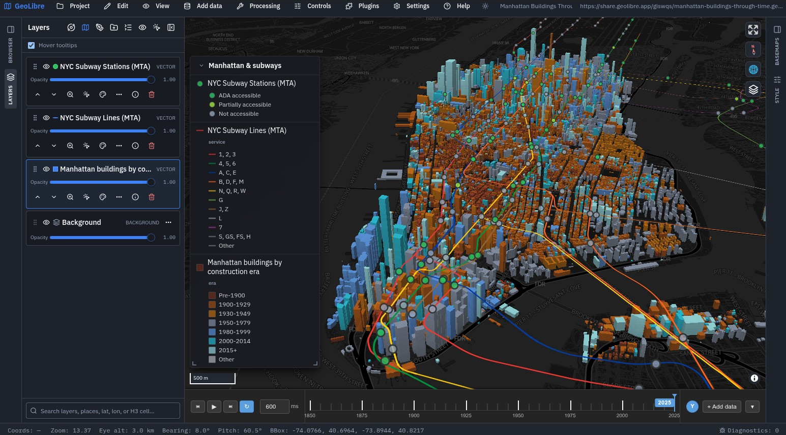

# Summary

GeoLibre is a free and open-source geographic information system (GIS) for
visualizing, exploring, and analyzing geospatial data. A single React and
TypeScript code base ships as a web application that needs no installation, as
native desktop applications for Windows, macOS, and Linux built with Tauri, as
native Android and iOS apps, as a Jupyter widget controlled from Python, and
as an R package for RStudio, Quarto, R Markdown, and Shiny. In
every one of these environments the data are read and processed on the user's
own device: vector formats are parsed in the browser by DuckDB-WASM Spatial
[@raasveldt2019duckdb], cloud-optimized rasters and tile archives are streamed
with HTTP range requests, and more than 1,000 geoprocessing tools for terrain,
hydrology, LiDAR, remote sensing, and vector analysis execute locally as
WebAssembly [@haas2017webassembly]. Maps can be drawn by MapLibre GL JS (the
default), Mapbox GL JS, CesiumJS, or the ArcGIS Maps SDK for JavaScript, and
an entire session, including layers, styles, the camera, and analysis
history, is saved to an open, documented JSON project file that can be
reopened in any of the deployment targets (\autoref{fig:app}).

# Statement of need

Geospatial research increasingly depends on large, openly published datasets
distributed in cloud-native formats such as Cloud Optimized GeoTIFF (COG),
GeoParquet, PMTiles, FlatGeobuf, and Zarr, and indexed by SpatioTemporal Asset
Catalogs (STAC) [@abernathey2021cloud]. Working with these data still usually
requires either a full desktop GIS, which must be installed and maintained on
each machine, or a hosted cloud platform, which requires an account and moves
the data and the computation to a vendor's servers. Both are obstacles in
teaching, in workshops, in field settings, on locked-down institutional
computers, and when data are sensitive. Studies of reproducibility in
GIScience also report that published analyses often cannot be re-run because
the data, software environment, or processing steps are not shared in a usable
form [@nust2018reproducible; @kedron2021reproducibility].

GeoLibre addresses these gaps with a GIS that opens from a URL in a browser
tab, keeps data on the user's machine, and records the state of a map,
including its data sources, symbology, and processing history, as a plain
project file that can be shared, version-controlled, and reopened by anyone.
Its target audience includes researchers and students who need to inspect and
analyze geospatial data without setting up a software environment, instructors
who need every participant in a class to have the same working tool within
minutes, and computational scientists who analyze data in Python notebooks and
want an interactive map interface tied to their code [@kluyver2016jupyter].
The `geolibre` Python package, published on PyPI and conda-forge, embeds the
full application as a notebook widget with two-way synchronization, so layers
added in code appear in the interface and edits made in the interface can be
read back in Python. The `geolibre` R package, published on CRAN, embeds the
same map in RStudio, Quarto, R Markdown, and Shiny through htmlwidgets and
writes the same project files, so maps move freely between R and the
application.

# State of the field

QGIS and GRASS GIS [@neteler2012grass] are mature, extensible open-source
desktop GIS, and SAGA [@conrad2015saga] and WhiteboxTools
[@lindsay2016whitebox] provide large libraries of geoprocessing algorithms.
They are the right choice for many production workflows, but they are native
applications that must be installed, and none of them offers an official
in-browser build. Commercial platforms such as ArcGIS Pro and ArcGIS Online
offer comparable breadth but are proprietary, and the online services place
data and analysis on vendor infrastructure. Google Earth Engine
[@gorelick2017google] makes planetary-scale raster analysis accessible but is
a hosted service that requires an account and whose computation is not
reproducible outside that service. Browser-based visualization tools such as
kepler.gl and Felt make maps easy to build and share but offer little
geoprocessing, and Python libraries such as GeoPandas [@jordahl2020geopandas],
geemap [@wu2020geemap], and leafmap [@wu2021leafmap] support analysis in code
rather than through an interactive GIS interface.

We built GeoLibre as a new project rather than contributing these features to
an existing one because the gap is architectural. Running a complete GIS in a
browser tab, without a server, requires the user interface, the data readers,
and the geoprocessing engines to be compiled for the web platform from the
start. Retrofitting that onto a native code base designed around GDAL
[@gdal2026] and a desktop widget toolkit would amount to a rewrite. At
the same time, GeoLibre deliberately reuses existing libraries wherever it can:
it renders through established web map engines, reads data with DuckDB and
standard JavaScript format libraries, and exposes the Whitebox algorithms
through WebAssembly. It also interoperates with the tools it is compared
against: it reads QGIS `.qgs`/`.qgz` and ArcGIS Pro `.aprx` project files, and
it imports and exports OGC SLD, QGIS QML, and Mapbox GL style documents.

# Software design

GeoLibre is an npm workspaces monorepo of focused TypeScript packages:
`@geolibre/core` holds domain types, the project schema, and the application
store; `@geolibre/map` holds the rendering-engine adapters and layer
synchronization; `@geolibre/processing` holds a registry of client-side
algorithms; `@geolibre/plugins` defines the plugin interface and the built-in
plugins; and `@geolibre/embed` is a typed client for embedding GeoLibre in
other web pages. Four design decisions shape the system.

*A single, engine-neutral store.* All application state lives in one Zustand
store as plain data records, never as objects owned by a mapping library. User
interface components change the store, and each rendering engine subscribes to
it and reconciles its own sources and layers. This one-way data flow is what
allows the same project to be drawn by four different engines, side by side in
synchronized panes, and it makes the project file a direct serialization of the
store rather than a separate export format. Engines declare their capabilities
explicitly, so a layer or plugin that one engine cannot draw is kept in the
project and suspended rather than lost when the user switches engines. A lint
rule forbids engine-specific modules from importing one another, which keeps
the engine boundary enforceable as the code grows.

*Client-side computation first.* Analysis runs in the browser by default,
using DuckDB-WASM for spatial SQL, Turf.js for vector operations, and a
WebAssembly build of the Whitebox geoprocessing suite for raster, terrain,
hydrology, and LiDAR tools. The trade-off is that very large analyses are
bounded by the memory and processing power of the user's device. In exchange,
the same tools work on the hosted web app, the desktop app, and mobile devices
without a server, and data never leave the user's machine. An optional Python
sidecar (FastAPI with GeoPandas and rasterio) extends the desktop build for
users who need it; when it is absent, the interface falls back to the
client-side engines.

*One web code base, several shells.* The desktop and mobile builds wrap the
web application in Tauri, which adds native file dialogs and local file
access, rather than maintaining separate native front ends. The Python package
bundles a build of the same application into its wheel. This keeps features
consistent across platforms at the cost of inheriting the limits of the
platform web view, such as WebGL driver differences.

*An open, documented project format and extension points.* Projects are stored
as versioned JSON with a documented schema, so they can be
inspected, diffed, generated by scripts, and reviewed in version control. The
Python package and a Model Context Protocol (MCP) server write the same format, so
maps can be authored from code or by software agents and then opened in the
application. Third parties extend GeoLibre through a TypeScript plugin
interface, either as built-in plugins or as external plugins loaded from a
manifest or a zip archive.

Quality is enforced by continuous integration on every pull request: unit tests
for the TypeScript packages, the Python sidecar, and the Python package;
Playwright end-to-end tests that drive the built web application in a browser;
type checking, linting, and a Rust check of the desktop crate; and coverage
floors that may not decrease.

# Research impact statement

GeoLibre has been developed in public since May 2026 and has had over 40 tagged
releases. More than 95 people have contributed code to the repository, the project has been starred by over 8,400
GitHub users and forked more than 950 times, and its issue tracker and
discussion forum receive bug reports, feature requests, and questions from
users outside the development team. The documentation includes a gallery of
105 reproducible map projects built from public open data, each of which can be
opened, inspected, and modified from a single link. GeoLibre is also used in
teaching: it is the GIS software for the undergraduate course *Our Digital
Earth* at the University of Tennessee, Knoxville, in Fall 2026, and the basis
of a full-day cloud-native GIS workshop at the Nevada Geographic Information
Society 2026 conference. In both, every participant runs the software in a web
browser with no installation, and the workshop materials are published in the
repository. GeoLibre builds on and extends the Python
geospatial tools maintained by the first author, including geemap
[@wu2020geemap], leafmap [@wu2021leafmap], and samgeo [@wu2023samgeo; @Osco2023], whose
Segment Anything [@kirillov2023segment] workflows are available through
GeoLibre's AI segmentation tools.

# AI usage disclosure

Generative AI was used extensively in developing GeoLibre. Most of the source
code, tests, and documentation were written with Anthropic's Claude models,
primarily Claude Opus 5.5, through the Claude Code command-line tool. The assistance covered code generation, refactoring, debugging,
test writing, documentation, and translation of the user interface into other
languages. Automated reviewers (GitHub Copilot, CodeRabbit, and Claude) also
comment on pull requests. This paper was drafted with Claude Opus 5.5 from the
repository's documentation and history, and was then reviewed and edited by
the authors, who verified every claim and reference.

The authors set the project's scope and made the primary architectural and
design decisions, including the engine-neutral store, the client-side-first
processing model, the choice of rendering engines and data libraries, and the
project format. All AI-generated changes are submitted as pull requests that
the authors review, test, and validate before merging; they must pass the
continuous-integration suite described above, and user-facing behavior is
checked in the running application. The project's README and documentation
disclose AI use to users and ask them to report anything that looks wrong.

# Acknowledgements

We thank the contributors to GeoLibre and the maintainers of the open-source
projects it is built on, including MapLibre GL JS, deck.gl, CesiumJS,
DuckDB-WASM, Turf.js, Tauri, React, GDAL, and the Whitebox geoprocessing
suite. A complete list is maintained on the project's Acknowledgements page.

# References
